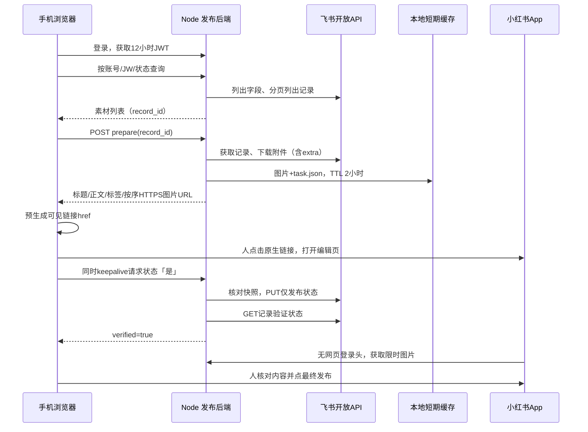

# 技术实现：飞书到手机 App 的交接

## 组件与数据流



最后两步可能并行/顺序不同。网页没有可信的 App 发布完成回调。状态回写成功只证明飞书字段符合点击规则，不证明小红书发布。

## 源码地图

| 文件 | 责任 |
|---|---|
| `src/server.cjs` | 读取配置，选择真实/模拟适配器，启动HTTP与过期清理 |
| `src/config.cjs` | HTTPS根地址、私有路径、会话密钥、运行模式验证 |
| `src/app.cjs` | 登录、JWT、速率限制、安全头、静态资源和队列HTTP接口 |
| `src/services/accounts.cjs` | scrypt加盐校验、身份版本、撤销旧JWT |
| `src/services/queue.cjs` | 飞书adapter、字段映射、列表、素材准备、快照校验、状态回读 |
| `src/demo.cjs` | 三条合成记录与占位PNG，临时演示账号，不发飞书请求 |
| `public/queue.js` | 筛选、预览、原生链接点击、keepalive回写、返回网页重试 |
| `public/direct-route.js` | iOS / Android 协议负载构造，仅图文 |
| `public/request.js` | fetch+JSON总超时；不依赖AbortSignal.timeout |
| `scripts/*` | 安全初始化、创建账号、只读检查、配置诊断 |

## 配置与字段映射

`.env` 由 dotenv 载入；私有 `data/feishu.json` 包含四个飞书身份/表格字段。`fields` 将内部标准字段映射到实际列名；adapter 的输入/输出都统一成标准字段。列字段ID原样保留，用来构造附件下载权限。未映射列不返回给前端。

真实 adapter 用 `tenant_access_token`；提前120秒视为过期。鉴权25秒超时，飞书请求45秒超时；分页取全字段/记录，再在服务器按账号/JW/状态过滤。这是简单表规模实现，没有服务端检索或增量同步；大表可扩展API筛选/索引。配置修改后重启服务。

严格要求6个文本列type1、附件type17、单选type3含是/否；检查结果缓存60秒。JW格式 `^JW\d+$`；账号/模板/标题/正文不能为空；标签可空。列表会排除无账号或无JW的行，但完整内容校验在prepare执行。

## 附件为何必须经过服务器

飞书附件 file_token 不是可直接给 App 的永久图片 URL。服务器带应用身份下载附件，查询参数：

```json
{
  "bitablePerm": {
    "tableId": "配置的数据表ID",
    "attachments": {
      "附件字段ID": {"所选记录ID": ["附件file_token"]}
    }
  }
}
```

这是 `extra` 参数的JSON字符串；完整 API 地址为 `drive/v1/medias/<file_token>/download`。不把飞书 token 或 secret 暴露给 App。每条最多3个下载worker，全进程下载起始间隔至少220ms，保持附件数组原始顺序。只接收图片MIME，文件非空且每张≤20MiB。任意图片失败都不会发布部分清单。

缓存每次准备生成24随机字节（48位hex字符串）目录：

```text
data/media/<random-token>/1
data/media/<random-token>/2
data/media/<random-token>/task.json
data/media/status-audit.jsonl
```

`task.json` 保存字段、record_id、图片类型/大小、快照指纹、expiresAt和公网地址。客户端看不到fingerprint或磁盘files列表。图片只能通过 `/api/queue/media/<token>/<1-based-index>` 访问，限制token格式、序号和有效期；没有目录列表。半成品无task.json不能被读取。

URL本身是持有者权限；有效期2小时。访问返回图片实际MIME、nosniff、no-store、no-referrer。2小时后立即拒绝；清理任务每15分钟删除过期目录。审计日志单独保留，由运维安排轮转。

## App 路线与负载

来源：Lumi 的 `lumi/xhs_qr_preview.html`，原始blob `3d5f0c1e1a87c92f82b9037875333cc72af38d7f`。这是协议复用，不是官方SDK调用，不消耗官方 appKey。完整字段以 `public/direct-route.js` 和测试为准。

### iOS

外层 `https://oia.xiaohongshu.com/oia?deeplink=<encoded>`，内层 `xhsdiscover://post_new_note?...`。attach中含 note_title、note_text、note_text_v2、images、image_resources。标题/正文保留Unicode和换行；普通 `#标签` 转换为 `#标签[话题]#`，已格式化标签避免重复追加。是否识别成可点击话题仍须App内检查。

### Android

`xhsdiscover://share_sdk?data=<UTF8-JSON-base64>`，负载包括：

```json
{
  "note_info": {
    "title": {"value": "标题"},
    "content": {"value": "正文和标签"},
    "image_info": [{"uri": null, "url": "https://公开图片URL"}]
  },
  "share_type": "note",
  "sdk_version": "1.0.0",
  "third_app_package": "system_album_other",
  "third_app_version": "1.0.0",
  "share_session_id": "时间戳+随机值",
  "did": "",
  "start_share_timestamp": 0,
  "fromJsSdk": false
}
```

这是实际代码中的模拟协议字段，不代表本项目已注册成系统相册或获得官方SDK权限。默认浏览器transport是：

```text
intent://share_sdk?data=...#Intent;scheme=xhsdiscover;package=com.xingin.xhs;end
```

备用模式原样使用 `xhsdiscover://`。不设APK下载fallback。不用 `window.open`、隐藏链接模拟点击或回写完再跳转。**选素材后预生成可见anchor的href，合法手机click事件启动回写但不await、不preventDefault**，交给浏览器原生导航保留用户手势。

桌面没有交接href；选择与设备不符的平台阻止写入和跳转；部分内嵌浏览器UA被阻止。检测不是兼容性保证。图片必须HTTPS且不能含URL用户名/密码，避免把认证信息塞给App。

## HTTP接口

| 方法 / 地址 | 鉴权 | 返回或作用 |
|---|---|---|
| GET `/api/health` | 公开 | `{ok:true,demo:boolean}`，不暴露配置 |
| POST `/api/login` | 登录名/密码 | `{code:200,data:{token}}`，12h JWT |
| GET `/api/queue/records` | Bearer JWT | accounts、numbers、items；query:account,jw,status=否/是/all |
| POST `/api/queue/records/:id/prepare` | Bearer JWT | 一条完整任务、图片URL、expiresAt |
| POST `/api/queue/tasks/:token/status` | Bearer JWT | body:`{status:"是"}`/否；回读通过才verified=true |
| GET `/api/queue/media/:token/:index` | URL随机凭证 | 原始图片；App无须JWT；过期410 |

业务JSON为 `{code:200,data:...}`；错误为 `{code:HTTP状态码,message:"可读提示"}`。400输入不合法、403登录/身份错误、404任务不存在、409字段/素材变化、410过期、502飞书请求/回读失败。网络错误不透出Axios原对象，避免泄露secret和header。

## 状态、并发与恢复

准备任务指纹是SHA256，输入为6个文本字段与附件file_token/name；**不含状态字段**，所以允许是↔否。每次回写重新读记录比较指纹，内容变化返回409，不能拿旧任务改新的素材。只PUT发布状态，再GET验证，并写audit。重复写相同状态跳过PUT但仍读回。

`preparing`和`writes`是进程内Map，分别合并同一record并行准备、串行状态操作。飞书没有本项目可用的事务/CAS，外部同时改字段仍有检查后竞争窗口；限制同一记录并行编辑，必要时扩大为分布式锁/任务版本。当前仅支持单Node进程、单副本。

前端localStorage保存JWT与pending状态任务。click通过后先记录pending，fetch设置keepalive。网络中断保留pending，回到网页/重载时重试幂等回写；400/404/409/410终止旧任务，403要求重登。离开浏览器时keepalive可能被系统取消，不能承诺一定成功，必须看回读确认。

## 扩展时必须保留的约束

- OSS：定义存储put/get-url/expiry/delete接口，改prepare存储；URL保持HTTPS、顺序与足够TTL。不要直接公开整Bucket。
- 多用户隔离：账号绑定允许的表/素材账号，在服务端过滤并校验prepare和status；仅隐藏前端选项不够。
- 多实例：共享缓存与任务，分布式锁，统一JWT和审计；先补竞争测试再扩容。
- 新类型：视频、超过18张、表格关联字段要增加明确类型处理，不把它们伪装成图文。
- 发布成功识别：引入平台可信回调/授权机制前，保留点击回写含义，不靠浏览器失焦或App打开猜成功。
